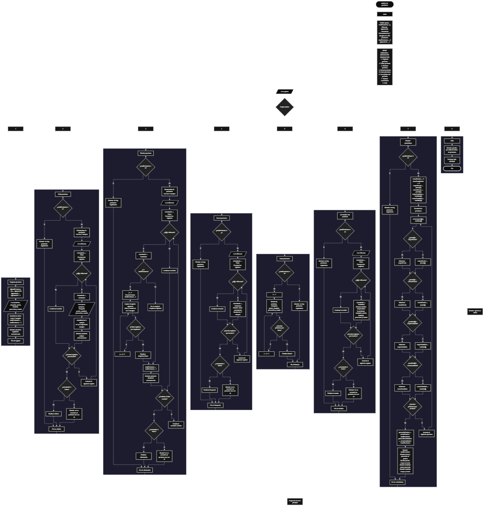

 

Este proyecto, llamado <b>archivo de productos</b>, fue desarrollado en <b>pseint</b> como un ejercicio práctico para fortalecer la lógica de programación mediante la creación de un sistema de gestión de productos desde la consola. El programa cuenta con un menú principal de ocho opciones que permite <b>registrar, editar, eliminar, buscar, listar, consultar los detalles y mostrar estadísticas</b> de los productos almacenados. Cada producto contiene información como el identificador, el nombre, la categoría, el precio, la cantidad disponible, el proveedor y el estado. Para organizar estos datos se utilizan siete arreglos paralelos con una capacidad definida de <b>100 posiciones por arreglo</b>. Durante su desarrollo se aplicaron conceptos fundamentales de programación, como variables, arreglos, estructuras condicionales, ciclos repetitivos y estructuras de selección, además de procedimientos para buscar, modificar, eliminar y reorganizar registros. Este proyecto permite poner en práctica los conocimientos adquiridos en PSeInt y sirve como base para desarrollar sistemas de gestión de inventarios más avanzados utilizando otros lenguajes y tecnologías.

<h2 align="center">⚙️ Funcionamiento del menú principal</h2>

### ➕ Registrar producto

La opción <b>1) registrar producto</b> permite incorporar un nuevo producto al inventario. Al iniciar el registro, el programa asigna un identificador mediante la variable <b>siguienteid</b> y lo almacena en la posición correspondiente del arreglo <b>id</b>. Después, incrementa el valor de esta variable para que el siguiente producto registrado reciba un identificador nuevo. A continuación, solicita el <b>nombre del producto, la categoría, el precio, la cantidad, el proveedor y el estado</b>, almacenando cada dato en su respectivo arreglo. Una vez introducida toda la información, incrementa la variable <b>totalproductos</b> en uno y muestra el mensaje <b>"producto registrado correctamente."</b>. Aunque los arreglos tienen una capacidad definida de 100 posiciones, el código actual no comprueba si se ha alcanzado ese límite antes de registrar otro producto.

### ✏️ Editar producto

La opción <b>2) editar producto</b> permite modificar los datos de un producto que ya se encuentra registrado. Primero, el programa comprueba si la variable <b>totalproductos</b> es igual a cero. Si no existen registros, muestra el mensaje <b>"no hay productos registrados."</b>. En caso contrario, presenta una lista de los productos con su identificador, nombre, categoría, precio, cantidad, proveedor y estado. Después, solicita el identificador del producto que se desea editar y utiliza la variable <b>idbuscar</b> para almacenar el valor introducido. La variable lógica <b>encontrado</b> se inicializa en falso y un ciclo <b>para</b> recorre los identificadores registrados. Cuando encuentra una coincidencia, cambia la variable a verdadero y solicita los nuevos valores del nombre, la categoría, el precio, la cantidad, el proveedor y el estado. Los datos se actualizan directamente en sus respectivos arreglos, mientras que el identificador permanece sin cambios. Finalmente, muestra el mensaje <b>"producto editado correctamente."</b>. Si el identificador no coincide con ningún registro, presenta el mensaje <b>"no se encontró un producto con ese id."</b>.

### 🗑️ Eliminar producto

La opción <b>3) eliminar producto</b> permite eliminar un producto registrado mediante su identificador. Antes de realizar la operación, el programa comprueba si existen productos almacenados. Si el inventario está vacío, muestra el mensaje <b>"no hay productos registrados."</b>. Si existen registros, presenta una lista con los datos de cada producto y solicita el identificador que se desea eliminar. Después, inicializa la variable lógica <b>encontrado</b> en falso y recorre los identificadores mediante un ciclo <b>para</b>. Cuando encuentra el producto solicitado, cambia la variable a verdadero y comprueba si su posición es anterior a la última posición ocupada mediante la condición <b>i &lt; totalproductos</b>. Si se cumple, utiliza un segundo ciclo <b>para</b>, controlado por la variable <b>j</b>, para desplazar una posición hacia la izquierda los datos de los arreglos <b>id, producto, categoria, precio, cantidad, proveedor y estado</b>. Posteriormente, disminuye la variable <b>totalproductos</b> en uno y muestra el mensaje <b>"producto eliminado correctamente."</b>. Si no encuentra el identificador solicitado, presenta el mensaje <b>"no se encontró un producto con ese id."</b>. El código no limpia expresamente la última posición después de la eliminación; simplemente deja de considerarla dentro del total de productos registrados.

### 🔎 Buscar producto

La opción <b>4) buscar producto</b> permite localizar un producto mediante su identificador. Primero, el programa comprueba si existen productos registrados. Si el inventario está vacío, muestra el mensaje <b>"no hay productos registrados."</b>. En caso contrario, solicita el identificador del producto y almacena el valor en la variable <b>idbuscar</b>. A continuación, inicializa <b>encontrado</b> en falso y utiliza un ciclo <b>para</b> para recorrer los registros desde la primera posición hasta <b>totalproductos</b>. Cuando encuentra una coincidencia entre <b>id[i]</b> e <b>idbuscar</b>, cambia la variable lógica a verdadero, muestra el mensaje <b>"datos encontrados"</b> y presenta el identificador, el nombre, la categoría, el precio, la cantidad, el proveedor y el estado del producto. Si finaliza el recorrido sin encontrar coincidencias, muestra el mensaje <b>"no se encontró un producto con ese id."</b>. Esta operación facilita la consulta de un registro específico sin necesidad de revisar manualmente todo el inventario.

### 📋 Listar productos

La opción <b>5) listar productos</b> permite visualizar todos los productos que se encuentran registrados en el inventario. Primero, el programa comprueba si la variable <b>totalproductos</b> es igual a cero. Si no existen productos almacenados, muestra el mensaje <b>"no hay productos registrados."</b>. En caso contrario, presenta el encabezado <b>"datos registrados"</b> y utiliza un ciclo <b>para</b> para recorrer los arreglos desde la primera posición hasta el total actual de productos. En cada iteración, muestra el identificador, el nombre, la categoría, el precio, la cantidad, el proveedor y el estado de un producto en una misma línea, separando los campos mediante el símbolo <b>|</b>. De esta manera, permite consultar los registros existentes de forma organizada sin necesidad de buscar cada producto individualmente.

### 📄 Ver detalles del producto

La opción <b>6) ver detalles del producto</b> permite consultar de manera individual la información de un producto específico. Primero, el programa comprueba si existen productos registrados. Si el inventario está vacío, presenta el mensaje <b>"no hay productos registrados."</b>. En caso contrario, solicita el identificador del producto que se desea consultar y lo almacena en la variable <b>idbuscar</b>. Después, inicializa la variable <b>encontrado</b> en falso y recorre los registros mediante un ciclo <b>para</b>. Cuando encuentra una coincidencia, cambia la variable a verdadero y muestra el encabezado <b>"detalles del producto"</b>, seguido de cada campo por separado: identificador, producto, categoría, precio, cantidad, proveedor y estado. Si el identificador introducido no corresponde a ningún registro, muestra el mensaje <b>"no se encontró un producto con ese id."</b>. Esta función facilita la consulta detallada de la información almacenada para un producto determinado.

### 📊 Mostrar estadísticas

La opción <b>7) mostrar estadísticas</b> permite obtener un resumen numérico de los productos registrados. Primero, el programa comprueba si existen registros. Si no hay productos almacenados, muestra el mensaje <b>"no hay productos registrados."</b>. En caso contrario, inicializa las variables <b>sumaprecios</b> y <b>sumacantidades</b> en cero. También establece <b>mayorprecio</b> y <b>menorprecio</b> con el precio del primer producto, y <b>mayorcantidad</b> y <b>menorcantidad</b> con su cantidad inicial. A continuación, utiliza un ciclo <b>para</b> para recorrer todos los productos registrados, acumular los precios y las cantidades, y comparar cada valor con los máximos y mínimos actuales. Si encuentra un precio superior o inferior, actualiza el máximo o el mínimo correspondiente. El mismo procedimiento se aplica a las cantidades. Una vez finalizado el recorrido, calcula <b>promedioprecios</b> dividiendo la suma de precios entre el total de productos y <b>promediocantidades</b> dividiendo la suma de cantidades entre ese mismo total. Finalmente, presenta el número de productos registrados, la suma y el promedio de los precios, el precio mayor y menor, la cantidad total en inventario, el promedio de cantidades y las cantidades mayor y menor. Estas estadísticas permiten conocer el comportamiento general de los valores almacenados en el inventario.

### 🚪 Salir del menú principal

La opción <b>8) salir</b> permite finalizar la ejecución del programa y muestra el mensaje <b>"gracias por utilizar archivo de productos."</b>. El menú principal se encuentra dentro de una estructura repetitiva <b>repetir ... hasta que</b>, que mantiene el programa en funcionamiento mientras el usuario realiza las operaciones disponibles. La condición de salida es <b>hasta que opcion = 8</b>, por lo que al seleccionar la opción 8, el ciclo termina y el algoritmo finaliza. Si el usuario introduce un valor que no coincide con ninguna de las opciones definidas, el bloque <b>de otro modo</b> muestra el mensaje <b>"opcion no valida."</b>.

<h2 align="center">🧠 Temas aplicados en el proyecto</h2>

### 📦 Variables

En este proyecto se utilizan variables para controlar el menú principal, llevar el registro del número de productos almacenados, asignar identificadores, recorrer los arreglos, buscar productos y determinar si una operación ha encontrado el registro solicitado. También se utilizan variables para realizar cálculos estadísticos relacionados con los precios y las cantidades. Cada variable cumple una función dentro de las diferentes operaciones del sistema.

🔢 **Opcion:** Almacena la opción seleccionada por el usuario en el menú principal.

📊 **Totalproductos:** Guarda la cantidad actual de productos registrados.

🆔 **Siguienteid:** Controla la asignación de identificadores nuevos y aumenta después de cada registro.

🔄 **I:** Funciona como contador en los ciclos utilizados para recorrer y consultar los arreglos.

🔁 **J:** Controla el desplazamiento de los datos de los arreglos durante la eliminación de un producto.

🔎 **Idbuscar:** Almacena el identificador introducido por el usuario para localizar el producto que desea editar, eliminar, buscar o consultar.

✅ **Encontrado:** Variable lógica que indica si se ha localizado un producto con el identificador solicitado.

📈 **Sumaprecios:** Acumula los precios de todos los productos registrados.

📦 **Sumacantidades:** Acumula las cantidades de los productos para calcular el total del inventario.

⬆️ **Mayorprecio y mayorcantidad:** Almacenan los valores máximos encontrados entre los precios y las cantidades.

⬇️ **Menorprecio y menorcantidad:** Almacenan los valores mínimos encontrados entre los precios y las cantidades.

➗ **Promedioprecios y promediocantidades:** Almacenan los promedios calculados a partir de las sumas y el total de productos.

Además, el código utiliza la variable <b>opcion</b>, la variable <b>totalproductos</b> y los contadores <b>i</b> y <b>j</b> para coordinar el funcionamiento de las operaciones. Las variables estadísticas se utilizan en el código, aunque no aparecen en las declaraciones iniciales mostradas al comienzo del algoritmo.

### 🗃️ Arreglos

En este proyecto se utilizan siete arreglos paralelos con una capacidad definida de <b>100 posiciones por arreglo</b>. Cada arreglo almacena un campo específico del producto y utiliza el mismo índice para relacionar todos los datos de un registro. Por ejemplo, la información del producto ubicado en la posición <b>1</b> se encuentra distribuida entre <b>id[1], producto[1], categoria[1], precio[1], cantidad[1], proveedor[1] y estado[1]</b>. Esta organización permite almacenar, recorrer, buscar, editar, mostrar y eliminar los registros de manera ordenada. La variable <b>totalproductos</b> determina cuántas posiciones se consideran ocupadas durante las operaciones del programa.

🆔 **Id[100]:** Almacena los identificadores asignados a los productos.

📦 **Producto[100]:** Almacena los nombres de los productos registrados.

🗂️ **Categoria[100]:** Almacena las categorías correspondientes a cada producto.

💰 **Precio[100]:** Almacena los precios de los productos mediante valores reales.

🔢 **Cantidad[100]:** Almacena las cantidades disponibles de cada producto mediante valores enteros.

🏭 **Proveedor[100]:** Almacena los nombres de los proveedores de los productos.

📋 **Estado[100]:** Almacena el estado indicado para cada producto.

### 🔀 Estructuras condicionales

En este proyecto se utilizan las estructuras <b>si ... entonces</b> y <b>si no</b> para comprobar si existen productos registrados antes de ejecutar determinadas operaciones, verificar si un identificador coincide con un producto almacenado y determinar si se debe mostrar un mensaje de error cuando no se encuentra un registro. También se utilizan condiciones para controlar el desplazamiento de los arreglos durante la eliminación, mediante la comparación <b>i &lt; totalproductos</b>, y para calcular los valores máximos y mínimos de los precios y las cantidades. Estas condiciones permiten que el programa tome decisiones según la información almacenada y el resultado de cada operación.

### 🔄 Estructuras repetitivas

En este proyecto se utilizan los ciclos <b>para</b> y <b>repetir ... hasta que</b>. Los ciclos <b>para</b> permiten recorrer los arreglos para mostrar los productos, buscar identificadores, editar registros y calcular estadísticas. Durante la eliminación, un ciclo adicional controlado por la variable <b>j</b> desplaza los datos de los registros posteriores para mantener organizadas las posiciones activas. Por otro lado, el ciclo <b>repetir ... hasta que</b> mantiene activo el menú principal y permite ejecutar distintas operaciones hasta que el usuario selecciona la opción 8.

### 🎯 Estructura según

La estructura <b>segun</b> evalúa el valor almacenado en la variable <b>opcion</b> y ejecuta el bloque de instrucciones correspondiente a la selección del usuario. Cada caso representa una operación específica del sistema: <b>registrar, editar, eliminar, buscar, listar, ver detalles, mostrar estadísticas o salir</b>. También se utiliza el bloque <b>de otro modo</b> para mostrar el mensaje <b>"opcion no valida."</b> cuando el valor introducido no coincide con ninguna de las opciones definidas en el menú principal.

### 🔢 Dimensionamiento de arreglos

El programa utiliza la instrucción <b>dimension</b> para establecer la capacidad de los siete arreglos que almacenan la información de los productos. Cada arreglo dispone de <b>100 posiciones</b>, lo que establece la capacidad prevista para el almacenamiento de registros. La variable <b>totalproductos</b> controla el número de productos considerados activos durante la ejecución. Sin embargo, el código actual no incluye una condición que compruebe si se ha alcanzado la capacidad antes de registrar un nuevo producto. Por ello, aunque la capacidad está definida en los arreglos, el límite no se valida explícitamente durante el registro.

### 🔄 Reorganización de registros

Cuando se elimina un producto que no se encuentra en la última posición ocupada, el programa utiliza un ciclo <b>para</b> controlado por la variable <b>j</b>, desde la posición del registro eliminado hasta <b>totalproductos - 1</b>. En cada repetición, los valores de la posición siguiente se copian sobre la posición actual en los siete arreglos: <b>id, producto, categoria, precio, cantidad, proveedor y estado</b>. Después, la variable <b>totalproductos</b> disminuye en uno. Así, los registros posteriores ocupan las posiciones anteriores sin dejar espacios intermedios dentro del rango activo. El identificador asignado al siguiente producto no se reinicia ni se reduce durante la eliminación, porque se controla mediante la variable independiente <b>siguienteid</b>.

<h2 align="center">¿Cómo se implementaron las operaciones crud en el proyecto?</h2>

Las operaciones <b>crud</b> se implementaron mediante las opciones del menú principal y permiten administrar los productos del inventario. La operación <b>crear</b> corresponde a <b>registrar producto</b>, donde se asigna un identificador y se almacenan los datos de un nuevo registro; la operación <b>leer</b> se realiza mediante las opciones <b>buscar producto, listar productos y ver detalles del producto</b>; la operación <b>actualizar</b> corresponde a <b>editar producto</b>, donde se modifican los datos de un producto existente; y la operación <b>eliminar</b> se realiza mediante <b>eliminar producto</b>, donde se retira un registro y se reorganizan los arreglos cuando es necesario. Estas operaciones utilizan variables, arreglos, condicionales y ciclos para gestionar la información almacenada durante la ejecución del programa.

<h2 align="center">Diagrama de flujo del proyecto</h2>

<h2 align="center">🛡️ Validaciones del programa</h2>

### 📭 No existen productos registrados

Esta comprobación se utiliza en las opciones de <b>editar, eliminar, buscar, listar, ver detalles y mostrar estadísticas</b>. El programa verifica si la variable <b>totalproductos</b> es igual a <b>0</b>. Si no existen productos registrados, muestra el mensaje <b>"no hay productos registrados."</b> y no continúa con la operación que necesita registros almacenados. Esta comprobación permite evitar que las operaciones intenten consultar datos de productos cuando el inventario está vacío.

### ❌ Producto no encontrado

Esta comprobación se utiliza en las operaciones de <b>editar, eliminar, buscar y ver detalles del producto</b>. El programa inicializa la variable lógica <b>encontrado</b> con el valor <b>falso</b> y recorre los identificadores registrados mediante un ciclo <b>para</b>. Cuando encuentra una coincidencia con el valor almacenado en <b>idbuscar</b>, cambia la variable a verdadero y ejecuta la operación correspondiente. Si finaliza el recorrido sin encontrar el identificador solicitado, muestra el mensaje <b>"no se encontró un producto con ese id."</b>. Esta comprobación permite informar al usuario cuando el producto que desea consultar o modificar no se encuentra registrado.

### ⚠️ Capacidad de almacenamiento

Los arreglos del programa están dimensionados para almacenar <b>100 posiciones</b> cada uno. Sin embargo, la opción de registro no comprueba si la variable <b>totalproductos</b> ha alcanzado ese límite antes de utilizar la siguiente posición. Por este motivo, el programa no implementa una validación explícita de capacidad máxima y no muestra un mensaje específico cuando se alcanza el límite previsto. Para que el sistema controle esa situación de forma segura, sería necesario incorporar una condición que verifique la capacidad antes de almacenar otro producto; dicha comprobación no forma parte del código actual.

### 🔢 Identificadores de productos

El programa utiliza la variable <b>siguienteid</b> para asignar un identificador a cada nuevo producto. Esta variable comienza en <b>1</b> y aumenta después de cada registro. Cuando se elimina un producto, el identificador asignado al siguiente registro no se modifica ni se reutiliza deliberadamente. Por ello, los identificadores pueden presentar saltos después de eliminar registros. El código utiliza el identificador como criterio de búsqueda y no como una posición directa del arreglo.

### ⚠️ Opción inválida

La estructura <b>segun</b> incluye el bloque <b>de otro modo</b>, que muestra el mensaje <b>"opcion no valida."</b> cuando el usuario introduce un valor que no coincide con las opciones del menú principal. Las opciones válidas están comprendidas entre <b>1 y 8</b>. La opción 8 muestra el mensaje de despedida y coincide con la condición de salida del ciclo principal, por lo que el programa termina su ejecución cuando se selecciona dicha opción.

<h2 align="center">🎯 Objetivo del proyecto</h2>

El objetivo principal de este proyecto es fortalecer la <b>lógica de programación</b> mediante el desarrollo de un sistema de gestión de productos en <b>pseint</b>. A través de su construcción se busca aplicar los conocimientos adquiridos sobre variables, arreglos, estructuras condicionales, ciclos repetitivos y estructuras de selección, integrándolos para resolver un problema de manera organizada. Además, el proyecto permite comprender cómo registrar, consultar, modificar y eliminar información, reorganizar registros y obtener estadísticas básicas de un inventario desde una aplicación de consola. De esta manera, constituye una base para desarrollar sistemas de gestión más completos y aplicar los mismos principios en otros lenguajes de programación y tecnologías.

